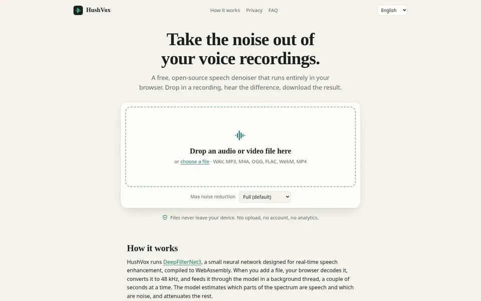
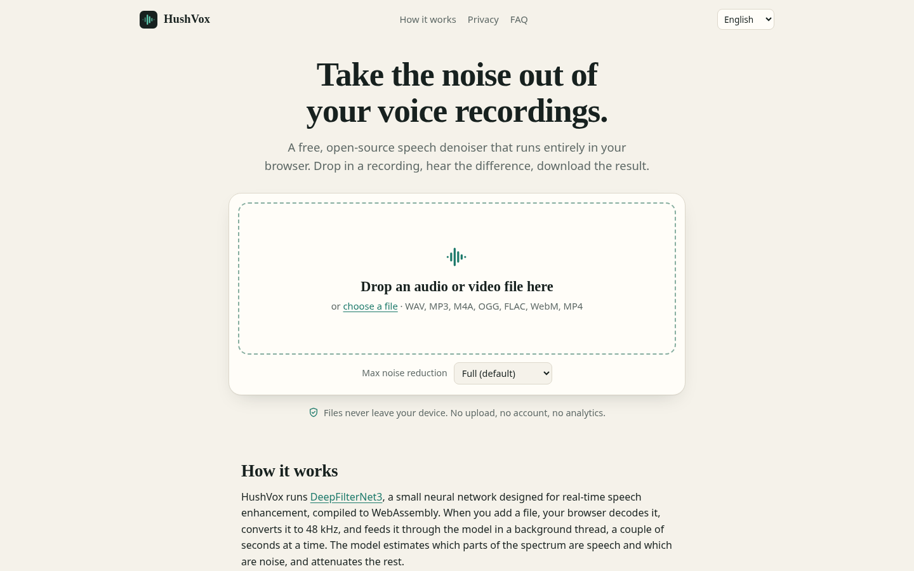
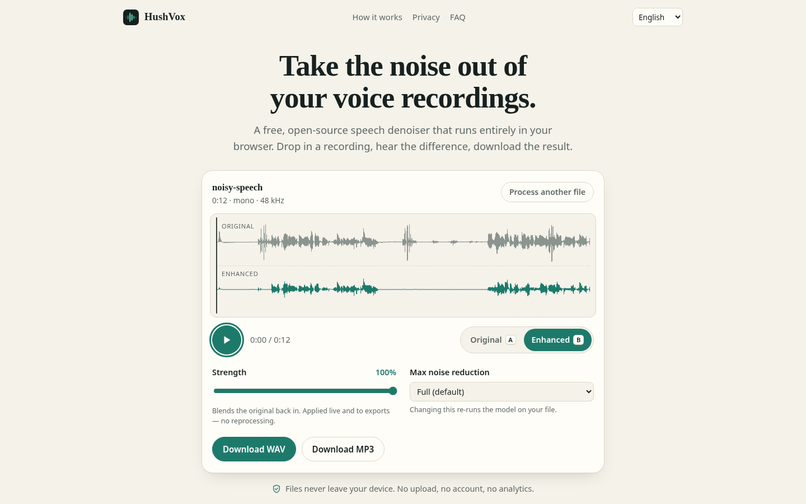

# HushVox

**Remove background noise from voice recordings — in your browser, with nothing uploaded.**

HushVox is a free, open-source (MIT) web app that runs the [DeepFilterNet3](https://github.com/Rikorose/DeepFilterNet) speech-enhancement model as WebAssembly. You drop in an audio or video file, compare original and enhanced audio, and export WAV or MP3. There is no backend, no account and no analytics.

**Live site:** https://xw2781.github.io/hushvox/



| Idle | Result (A/B player, strength, export) |
|---|---|
|  |  |

More: [desktop dark](shots/desktop-dark-result.png) · [mobile light](shots/mobile-light-result.png) · [mobile dark](shots/mobile-dark-result.png) · [full landing page](shots/desktop-light-fullpage.png)

## Privacy

Files are decoded and processed on your device (main thread decode → Web Worker → WASM). The built site makes no third-party requests (system fonts, no CDN, no analytics) and ships a strict Content-Security-Policy (`default-src 'self'`, `connect-src 'self'`). The e2e test fails if any request leaves the origin. The only network traffic is loading the site itself and the ~34 MB model (≈12 MB gzipped), fetched the first time you process a file and then kept in the browser's Cache API.

## Features

- Drag & drop / file picker; WAV, MP3, M4A/AAC, OGG, FLAC, WebM, and the audio track of videos — whatever your browser can decode.
- Mono and stereo (each channel processed separately); output keeps the original channel count at 48 kHz and the exact input length (the model's 30 ms latency is compensated).
- Chunked processing in a Web Worker with progress, ETA, "×realtime" and Cancel; long files don't need one giant buffer.
- Live **Strength** slider (dry/wet blend, no reprocessing), instant Original/Enhanced A/B at the same playhead, waveforms, keyboard shortcuts (Space, A / B / X, ←/→).
- Optional "max noise reduction" limit (re-runs the model).
- Export WAV (16-bit PCM) or MP3 (192 kbps, lazy-loaded LAME encoder via `wasm-media-encoders`, LGPL — see [NOTICE](NOTICE)). Names: `<name>-hushvox.wav|mp3`.

## Quality notes and limits

HushVox is a **noise suppressor**, not a generative "studio voice" re-synthesiser.

- Good at: steady and moderately varying background noise under speech (fans, hiss, room hum, street/office noise).
- Weaker at: loud, speech-like or very non-stationary noise (other talkers, clatter); heavy noise can leave the voice slightly processed or "watery".
- Music and other non-speech content are treated as noise and are not preserved.
- It does not remove reverb well and does not improve already-clean audio — use the Strength slider to blend some original back in.
- Processing is at 48 kHz mono per channel; other sample rates are resampled by the browser.

Measured numbers (headless Chromium, 8 logical CPUs; details and method in [tests/RESULTS.md](tests/RESULTS.md)). Speech: LibriVox public-domain clip; noise: a CC0 Freesound recording (and synthetic white / low-passed noise for context). These are indicative, single-speaker, single-noise measurements — not a benchmark.

| Test | Result |
|---|---|
| Noise-only RMS reduction, real noise, 0 dB / 10 dB input SNR | 14.8 dB / 12.6 dB |
| Speech-waveform SNR change vs clean reference, real noise, 0 dB / 10 dB | +4.1 dB / −4.4 dB |
| Same, synthetic white noise, 0 dB / 10 dB | +14.0 dB / +0.8 dB |
| Same, synthetic low-passed noise, 0 dB / 10 dB | +9.3 dB / +3.8 dB |
| Alignment (cross-correlation lag output vs clean) | 0 samples |
| Chunk-boundary continuity | worst sample step at 304 boundaries equals worst mid-chunk step (no clicks) |
| Speed, ~13 s file / ~10 min file | 12× / 13.7× realtime (excludes model load) |

The honest reading: noise-only passages are reduced substantially (12–15 dB for the real noise, far more for synthetic stationary noise), but **sample-accurate speech SNR is a harsh metric for a perceptual model** — with the real noise at 10 dB input SNR the waveform SNR vs. the clean reference went *down* (−4.4 dB) even though the noise is quieter, because the model alters speech detail. Listen with the A/B toggle rather than trusting one number, and lower Strength if the result sounds over-processed.

## Local vs. cloud enhancers

| | HushVox | Typical cloud enhancer |
|---|---|---|
| Where audio is processed | On your device | On the provider's servers |
| Upload / account | None | Usually both |
| Works offline after first load | Mostly (model cached by the browser) | No |
| Approach | Small noise-suppression network (DeepFilterNet3) | Varies; some use larger generative models |
| Speed | Your CPU (≈ 12–14× realtime on the machine above) | Provider queue + your connection |

No claim is made that HushVox matches any particular commercial product.

## Usage

Open the site, drop a file, press play, flip Original/Enhanced (A / B), set Strength, export.

## Development

```bash
npm ci
npm run dev            # dev server (strict CSP is applied to builds only)
npm run build          # typecheck + build to dist/
npm run test:e2e       # build + Playwright e2e against `vite preview`
npm run measure        # build + numeric quality/speed run -> tests/RESULTS.md (~1–2 min)
npm run shots          # regenerate shots/ and the README animation (needs ffmpeg)
```

Playwright needs a browser once: `npx playwright install chromium` (on Linux CI add `--with-deps`). `npm run test:e2e` uses the committed fixtures in [tests/fixtures](tests/fixtures/README.md) (public-domain speech + CC0 noise, mixed at known SNR). Anything in `tests/local-fixtures/` is git-ignored and never used by CI.

Layout: `src/audio/` (decode, worker, chunking, A/B player, WAV/MP3), `src/main.ts` (UI), `index.html` (landing/SEO content), `site.config.ts` (public URL in one place), `vite.config.ts` (CSP, robots.txt, sitemap.xml, FAQ JSON-LD).

## Deploy to GitHub Pages

`.github/workflows/deploy.yml` builds with `VITE_BASE=/hushvox/` and `VITE_SITE_URL=https://xw2781.github.io/hushvox/` and deploys on push to `main`. In the repository settings set **Pages → Source: GitHub Actions**. For another host or path: `VITE_BASE=/ VITE_SITE_URL=https://example.org/ npm run build` and serve `dist/`. `ci.yml` runs typecheck, build and the e2e test.

## Licenses

- HushVox: [MIT](LICENSE).
- Model and inference code: DeepFilterNet by Hendrik Schröter and contributors, **MIT OR Apache-2.0**; the WebAssembly npm package `@lofcz/deepfilternet-web` (model baked into `df_bg.wasm`) is by lofcz, same dual license. Full texts in [NOTICE](NOTICE).
- MP3 export: LAME (LGPL) through `wasm-media-encoders`, kept as a separate, lazy-loaded, unmodified chunk (details in [NOTICE](NOTICE)).
- Test fixtures: LibriVox recording (public domain) and a CC0 Freesound clip — provenance in [tests/fixtures/README.md](tests/fixtures/README.md). The original build brief is kept in [docs/BUILD-SPEC.md](docs/BUILD-SPEC.md).
